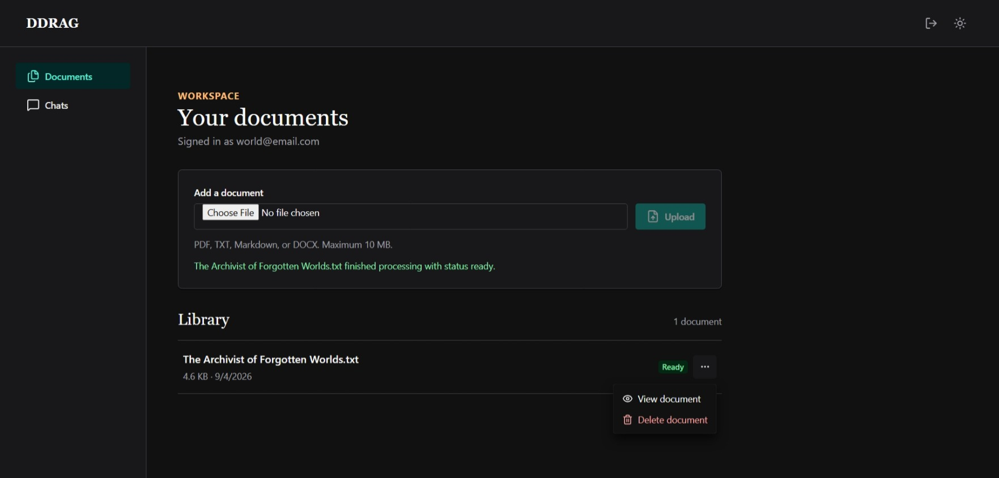

# DDRAG

**Drag, Drop, Retrieve, Augment, Generate**

DDRAG is a local-first retrieval-augmented generation (RAG) application for asking questions about your own documents. Upload PDF, DOCX, Markdown, or text files, retrieve relevant passages with PostgreSQL + pgvector, and generate answers locally through Ollama with source attribution.

Documents, embeddings, and model inference stay on your machine.

## Demo

🎥 **[Watch the DDRAG demo on YouTube](https://youtu.be/F0H7eqERpBA)**

The demo covers account creation, document ingestion, semantic retrieval, answers with source attribution, and persistent chat history.

### Interface preview

<p align="center">
  
</p>

*Ask questions against your documents and inspect the retrieved sources used for the response.*

<p align="center">
  
</p>

*Upload and manage documents from the authenticated document library.*

<p align="center">
  
</p>

*The same chat workflow on a narrow viewport.*

## Features

- JWT authentication with Argon2id password hashing and user-owned resources
- PDF, DOCX, Markdown, and TXT ingestion with validation and duplicate detection
- deterministic overlapping chunks with versioned chunking metadata
- local embeddings and answer generation through Ollama
- owner-scoped vector retrieval with PostgreSQL + pgvector
- grounded prompting, source attribution, and persistent chat history
- responsive React interface
- reproducible evaluation framework for retrieval, generation, grounding, refusal behavior, operational reliability, and latency

## How It Works

```text
Upload document
      ↓
Extract text
      ↓
Create overlapping chunks
      ↓
Generate embeddings
      ↓
PostgreSQL + pgvector
      ↓
Retrieve relevant owned chunks
      ↓
Build RAG context
      ↓
Generate locally with Ollama
      ↓
Return answer + source metadata
```

DDRAG treats retrieved document text as reference material and instructs the generation model to answer from the supplied context.

If retrieval produces no usable context, DDRAG returns an insufficient-information response without invoking the generation model. The current retrieval implementation does not use a relevance threshold, so receiving non-empty retrieval results does not by itself mean that a question is answerable.

## Architecture

```text
Browser / React + Vite
          │
          │ REST
          ▼
       FastAPI
          │
   ┌──────┼──────────────┐
   ▼      ▼              ▼
 Auth  Documents       Chats
          │              │
          ├── local document storage
          ├── PostgreSQL + pgvector
          └── Ollama
              ├── embeddings
              └── generation
```

FastAPI handles authentication, authorization, document ingestion, retrieval, generation, and persistence. The React frontend consumes the backend API.

See [docs/ARCHITECTURE.md](docs/ARCHITECTURE.md) for request flows, the data model, security boundaries, and design tradeoffs.

## Tech Stack

| Area | Technologies |
| --- | --- |
| Frontend | React, TypeScript, Vite, Chakra UI |
| Backend | Python 3.13, FastAPI, SQLAlchemy, Alembic |
| RAG | Ollama, vector embeddings, cosine-distance retrieval, grounded prompting |
| Data | PostgreSQL 16, pgvector, local document storage |
| Runtime | Docker, Docker Compose |
| Testing | pytest, dedicated PostgreSQL test database |

## Quick Start

### Prerequisites

Install:

- Git
- Docker with Docker Compose
- Ollama
- Node.js with npm

Python 3.13 is only required when running the backend directly outside Docker.

### 1. Clone DDRAG

```bash
git clone https://github.com/drZania/ddrag.git
cd ddrag
```

### 2. Configure the backend

Create `.env` only if it does not already exist.

**PowerShell**

```powershell
if (-not (Test-Path .env)) { Copy-Item .env.example .env }
```

**Linux/macOS**

```bash
test -f .env || cp .env.example .env
```

Replace the checked-in `JWT_SECRET` placeholder in a newly created `.env` with a unique local value.

### 3. Prepare Ollama and start the backend

```bash
ollama pull qwen3-embedding:0.6b
ollama pull qwen2.5:1.5b
docker compose up -d
```

DDRAG uses:

- `qwen3-embedding:0.6b` for embeddings
- `qwen2.5:1.5b` for answer generation

The backend applies Alembic migrations on startup and exposes its health endpoint at:

```text
http://localhost:8000/health
```

### 4. Start the frontend

In another terminal:

```bash
cd frontend
npm ci
```

Create `frontend/.env` only if it is absent.

**PowerShell**

```powershell
if (-not (Test-Path .env)) { Copy-Item .env.example .env }
```

**Linux/macOS**

```bash
test -f .env || cp .env.example .env
```

Then start Vite:

```bash
npm run dev
```

Open the URL printed by Vite, normally:

```text
http://localhost:5173
```

See [docs/DEVELOPMENT.md](docs/DEVELOPMENT.md) for Windows, Linux, and macOS setup, backend development, test database configuration, reset behavior, and troubleshooting.

<details>
<summary><strong>Agent-assisted setup</strong></summary>

<br>

DDRAG includes an [`AGENTS.md`](AGENTS.md) setup guide for repository-capable coding agents.

Paste this into Codex, Copilot, Claude Code, or another repository-aware coding agent:

```text
Set up DDRAG from https://github.com/drZania/ddrag.git for local development.

Follow the repository's AGENTS.md for prerequisites, environment setup,
Ollama models, Docker services, frontend setup, and verification.

Preserve existing environment files, databases, uploaded documents,
and Docker volumes. Do not commit or push anything unless explicitly requested.

Report which prerequisites and services were successfully verified and
any manual action still required.
```

</details>

## Testing

Backend tests require `TEST_DATABASE_URL` to point to a dedicated PostgreSQL database whose name contains `test`.

Never run the test suite against the development database.

See [Running Tests](docs/DEVELOPMENT.md#14-running-tests) before running:

```bash
pytest
```

Frontend verification:

```bash
cd frontend
npm run lint
npm run typecheck
npm run build
```

## Evaluation

DDRAG includes a reproducible evaluation framework designed to measure different parts of the RAG pipeline separately rather than collapsing them into a single accuracy score.

The evaluation covers:

- retrieval
- answer completeness and correctness
- grounding
- refusal and over-refusal behavior
- operational reliability
- latency

### Benchmark

The primary benchmark uses **40 manually reviewed questions** derived from the Caraga State University Student Handbook:

| Question type | Count |
| --- | ---: |
| Answerable | 34 |
| Ambiguous | 3 |
| Unanswerable | 3 |
| **Total** | **40** |

The source handbook and handbook-derived benchmark content are not redistributed. Reproducing the study requires an authorized copy matching the published [benchmark metadata](evaluation/benchmarks/README.md) and [corpus identity](evaluation/corpus/README.md).

### Baseline retrieval

Across the **37 retrieval-eligible questions**:

| Metric | Result |
| --- | ---: |
| Hit@5 | **0.973** |
| Recall@5 | **0.851** |
| CompleteEvidence@5 | **0.730** |

These are retrieval metrics, not overall answer-accuracy scores.

DDRAG usually retrieved at least one required evidence unit, while retrieving **all** evidence required by multi-evidence questions remained more difficult. Generation could also remain incomplete even when retrieval was complete.

### Controlled comparisons

The evaluation tested generation-model and prompt changes while holding the rest of the relevant configuration fixed.

Under the CSU Student Handbook benchmark and tested local environment:

- `qwen2.5:3b` did not provide enough evidence to justify replacing `qwen2.5:1.5b`
- the `ddrag-answer-completeness-v1` prompt improved some refusal behavior but did not improve the predeclared complete-retrieval generation-failure population
- DDRAG therefore retained `qwen2.5:1.5b` with `ddrag-production-v1`

The retained tested configuration is:

| Component | Retained configuration |
| --- | --- |
| Generation model | `qwen2.5:1.5b` |
| Embedding model | `qwen3-embedding:0.6b` |
| Prompt | `ddrag-production-v1` |
| Retrieval | owner-scoped pgvector cosine, top-K 5 |
| Chunking | 1000 characters, 200-character overlap |

Only the **generation model** and **generation prompt** received completed controlled comparisons. The embedding model, retrieval strategy, top-K, chunk size, and overlap were retained for continuity and should not be interpreted as experimentally established optima.

Qualitative judgments used blinded AI-assisted review with independent adjudication. Source identifiers shown by the application identify retrieved context but are not treated by the evaluation as automatic proof that every generated claim is grounded.

The study is intentionally scoped: it uses one corpus, a 40-question benchmark, local inference, and a limited number of controlled configurations. Results describe the tested DDRAG setup rather than universal model rankings.

For the complete methodology, evidence, results, and limitations, see:

- [Evaluation overview](evaluation/README.md)
- [Evaluation article](evaluation/reports/ddrag_evaluation_article.md)
- [Frozen evidence report](evaluation/reports/ddrag_evaluation_report.md)

## Design Highlights

**PostgreSQL + pgvector**  
Relational ownership data, document chunks, and vector embeddings remain in one transactional data store.

**Local inference**  
Embedding and generation requests are handled locally through Ollama.

**Inspectable retrieval**  
Responses preserve backend-provided source metadata so users can inspect the retrieved context associated with an answer.

**Backend-enforced ownership**  
Resource access is derived from the authenticated user, and document, retrieval, and chat queries are owner-scoped server-side.

**Evaluation-first measurement**  
Question-level results separate retrieval failures, generation failures, refusal behavior, operational errors, and latency rather than reporting a single opaque score.

See [Key Design Decisions](docs/ARCHITECTURE.md#21-key-design-decisions) for additional architecture discussion.

## Project Structure

```text
app/                    FastAPI application and RAG pipeline
frontend/src/           React interface and API client
migrations/             Alembic schema history
tests/                  Backend tests and database safety setup
evaluation/             Evaluation framework, metadata, evidence, and reports
docs/ARCHITECTURE.md    System design and request flows
docs/DEVELOPMENT.md     Local development and troubleshooting guide
AGENTS.md               Safe setup instructions for coding agents
```

## License

MIT License. See [LICENSE](LICENSE).